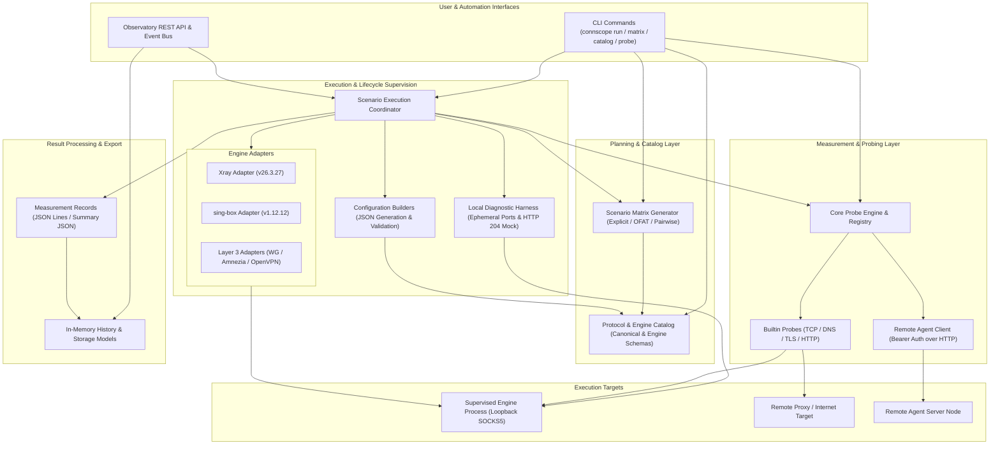

# ConnScope Architecture & System Design

ConnScope is organized as a modular, layered framework for protocol capability verification, matrix test planning, proxy adapter supervision, and network measurement.

---

## 1. High-Level System Architecture

The following diagram illustrates the relationship between ConnScope's primary components:

---

## 2. Core Architectural Layers

### Layer 1: Presentation & Invocation Layer
- **CLI (`connscope.cli`)**: Command-line interface with subcommands (`run`, `list`, `probe`, `catalog`, `matrix`). Enforces dry-run planning by default and requires explicit `--execute` opt-in to launch engine processes.
- **REST API & Events (`connscope.api`, `connscope.events`)**: Read-only interfaces exposing execution history, active scenarios, and real-time subscription events.

### Layer 2: Declarative Catalog & Planning Layer
- **Protocol Catalog (`connscope.scenarios.catalog`)**: In-memory registry defining canonical protocols (VLESS, VMess, Trojan, Shadowsocks, WireGuard, OpenVPN, AmneziaWG, Exclave, Aether), engines (Xray-core, sing-box), and supported capability mappings.
- **Scenario Matrix Generator (`connscope.scenarios.generator`)**: Combinatorial engine generating concrete test scenarios using `explicit`, `ofat` (One-Factor-At-A-Time), `pairwise` (all 2-way interactions), or `exhaustive` Cartesian planning with strict safety limits.

### Layer 3: Configuration & Engine Adapter Layer
- **Configuration Builders (`connscope.adapters.builders`)**: Transforms abstract parameter dictionaries into engine-native JSON configurations (`config.json` for Xray or sing-box). Applies security validation, parameter type checking, and secret redacting.
- **Engine Adapters (`connscope.adapters.xray`, `connscope.adapters.sing_box`, `connscope.adapters.base`)**: Supervises subprocess execution, captures stdout/stderr, monitors startup readiness on loopback SOCKS5 ports, and guarantees graceful cleanup (`SIGTERM` followed by bounded `SIGKILL`).
- **Layer 3 Interface Adapters (`connscope.adapters.wireguard`, `openvpn`)**: Manages tunnel devices with mock testing and non-privileged safety guarantees.

### Layer 4: Measurement & Probing Layer
- **Probe Engine & Registry (`connscope.core.engine`, `connscope.core.registry`)**: Executes synchronous or asynchronous probes against defined targets.
- **Builtin Probes (`connscope.probes`)**:
  - `tcp_connect`: Measures TCP 3-way handshake latency and socket connection state.
  - `dns_resolve`: Resolves A/AAAA records with lookup timing and query verification.
  - `tls_handshake`: Measures TLS negotiation duration, certificate validation, and ALPN negotiation.
  - `http_request`: Measures TTFB, response duration, HTTP status code, and header transfer.
- **Remote Agent (`connscope.agent`)**: Enables distributed probe delegation over HTTP using Bearer token authentication.

### Layer 5: Diagnostic Harness & Measurement Records
- **Local Diagnostic Harness (`connscope.scenarios.diagnostic`)**: Provides an ephemeral loopback test environment without external dependencies or listening port conflicts.
- **Deterministic Record Contracts (`connscope.scenarios.models`, `connscope.scenarios.reporting`)**: Structured schemas recording end-to-end execution metrics, timing breakdown, failure stages, evidence status, and redacted configurations.

---

## 3. Execution Lifecycle Flow

A typical scenario execution follows a deterministic 8-step lifecycle:

1. **Matrix Planning**: The CLI or user request specifies engine, profile, parameters, and strategy. The generator validates compatibility against the catalog.
2. **Pre-flight Engine Audit**: The coordinator inspects the host system to verify the engine binary is installed and executable.
3. **Configuration Synthesis**: The configuration builder generates the engine-specific JSON configuration, binds an ephemeral loopback inbound (e.g. SOCKS5 on `127.0.0.1:0`), and validates syntax.
4. **Subprocess Launch**: The engine adapter spawns the client process in an isolated subprocess with redirected pipes.
5. **Readiness Verification**: The coordinator probes the local SOCKS5 inbound until it accepts connections or reaches the startup timeout.
6. **Workload Probing**: The configured measurement probe (e.g. HTTP GET) is routed through the proxy inbound to the target.
7. **Process Teardown**: The adapter terminates the subprocess cleanly, removes temporary configuration files, and records any stderr warnings.
8. **Record Emission**: A structured measurement record is emitted to stdout, JSON Lines (`.jsonl`), and summary JSON.

---

## 4. Architectural Invariants & Safety Guarantees

1. **Dry-Run by Default**: Scenario generation and matrix run commands plan without executing unless `--execute` is explicitly passed.
2. **Port Non-Interference**: ConnScope uses ephemeral, OS-assigned ports (`port 0`) for dynamic bindings. It never binds to hardcoded host ports or interferes with external services (such as existing proxy instances on `127.0.0.1:10808`).
3. **Credential Redaction**: Sensitive parameter fields (`uuid`, `password`, `private_key`, `secret_key`, `psk`) are masked (`[REDACTED]`) before serializing records to disk or logging to stdout.
4. **Subprocess Containment**: All child processes run with bounded timeouts, mandatory process termination handlers, and explicit process group killing to prevent orphaned background processes.
